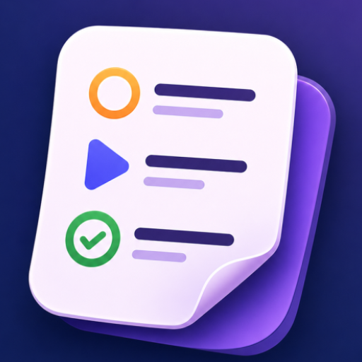

<div align="center">



# 🎬 My Seen

**Catat, pantau, dan nilai semua tontonanmu dalam satu aplikasi.**


</div>

---

## 📖 Tentang Aplikasi

**My Seen** adalah aplikasi Android untuk mencatat film dan serial yang ingin, sedang, atau sudah kamu tonton. Beri rating, tambahkan catatan, lalu lihat kebiasaan menontonmu lewat statistik dan grafik yang interaktif. Semua data tersimpan secara lokal di perangkat — tanpa perlu akun atau koneksi internet.

## ✨ Fitur

### 📺 Tontonanku
- **Tambah, edit, dan hapus** tontonan dengan judul, genre, status, rating, dan catatan.
- **Tiga status tontonan:** `Ingin Ditonton`, `Sedang Ditonton`, dan `Sudah Ditonton`.
- **Rating 1–10** untuk setiap tontonan.
- **Pencarian** berdasarkan judul secara real-time.
- **Filter chip** untuk menampilkan tontonan berdasarkan status.
- **Kartu ringkasan** jumlah tontonan per status.

### 📊 Statistik
- **Pie chart** distribusi status tontonan.
- **Bar chart** jumlah tontonan per genre.
- **Rata-rata rating** dari semua tontonan.
- **Top 5** tontonan dengan rating tertinggi.
- **Aktivitas terbaru** yang baru saja ditambahkan.
- **Filter waktu:** Semua Waktu, Hari Ini, Minggu Ini, Bulan Ini.

## 🛠️ Teknologi

| Kategori | Teknologi |
|---|---|
| Bahasa | Java 11 |
| UI | XML Layout, Material Components, ConstraintLayout, CardView, RecyclerView |
| Database | SQLite (`SQLiteOpenHelper` + DAO) |
| Grafik | [MPAndroidChart](https://github.com/PhilJay/MPAndroidChart) v3.1.0 |
| Font | Plus Jakarta Sans |
| Build | Gradle (Kotlin DSL), Android Gradle Plugin 9.1.1 |

## 📂 Struktur Proyek

```
app/src/main/java/com/della/myseen/
├── MainActivity.java            # Activity utama + Bottom Navigation
├── adapter/
│   └── ShowAdapter.java         # Adapter RecyclerView daftar tontonan
├── database/
│   ├── DatabaseHelper.java      # Pembuatan & versi database SQLite
│   └── ShowDAO.java             # Query CRUD, pencarian, dan statistik
├── dialog/
│   └── AddEditShowDialog.java   # Dialog tambah / edit tontonan
├── fragment/
│   ├── MyShowsFragment.java     # Halaman daftar tontonan
│   └── StatisticsFragment.java  # Halaman statistik & grafik
└── model/
    └── Show.java                # Model data tontonan
```

## 🚀 Cara Menjalankan

### Prasyarat
- [Android Studio](https://developer.android.com/studio) versi terbaru
- JDK 11 atau lebih baru
- Perangkat / emulator Android 8.0 (API 26) ke atas

### Langkah
1. **Clone repository**
   ```bash
   git clone https://github.com/sftdella/my-seen.git
   cd my-seen
   ```
2. **Buka di Android Studio** melalui `File → Open`, lalu pilih folder proyek.
3. Tunggu proses **Gradle Sync** selesai.
4. Klik **Run ▶** untuk menjalankan di emulator atau perangkat.

Atau build lewat terminal:
```bash
./gradlew assembleDebug
```
File APK akan tersedia di `app/build/outputs/apk/debug/`.

## 🗄️ Skema Database

Tabel `shows` pada database `myseen.db`:

| Kolom | Tipe | Keterangan |
|---|---|---|
| `id` | INTEGER | Primary key |
| `title` | TEXT | Judul tontonan |
| `genre` | TEXT | Genre |
| `status` | TEXT | Ingin / Sedang / Sudah Ditonton |
| `rating` | INTEGER | Rating 1–10 (opsional) |
| `added_date` | TEXT | Tanggal ditambahkan |
| `added_time` | TEXT | Waktu ditambahkan |
| `note` | TEXT | Catatan (opsional) |
| `added_timestamp` | INTEGER | Unix timestamp untuk filter waktu |

## 👩‍💻 Pembuat

**Della** — [@sftdella](https://github.com/sftdella)

---

<div align="center">

Dibuat dengan ❤️ menggunakan Android Studio

</div>
